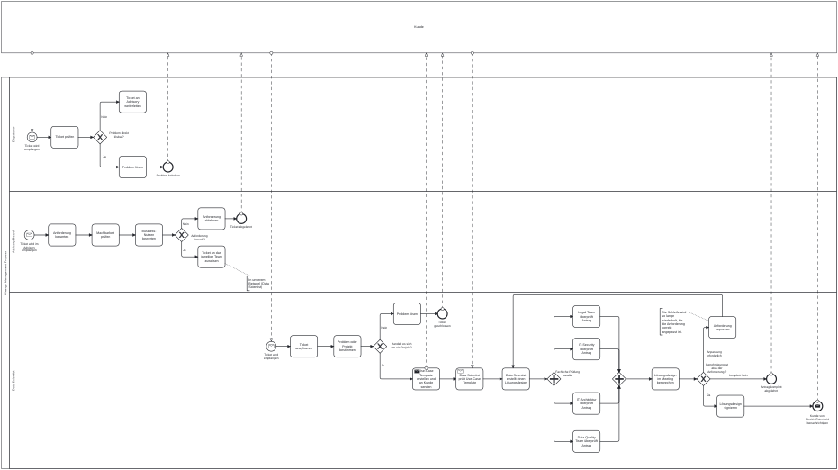

# Business Process Modeling with BPMN

## Overview

This project demonstrates the analysis and modeling of a real-world business process using **Business Process Model and Notation (BPMN)**.

The process was derived from an interview with a professional working in the **Data Science** field. Based on the collected information, the workflow for reviewing and approving data product requirements was analyzed, structured and modeled.

The project was created as part of coursework in **Business Process Management**.

## Process Scenario

The modeled process describes how a new requirement for a data product is reviewed before implementation.

The workflow involves several roles and organizational units, including:

- Dispatcher
- Advisory Board
- Data Scientist
- IT Architecture
- IT Security
- Data Quality
- Legal

The process contains multiple validation steps, decision points and feedback loops.

## BPMN Process Model

The BPMN model visualizes the complete requirement approval workflow, from the initial submission of a requirement to its final approval or rejection.



## Process Analysis

The analysis considered several aspects of the business process:

- Process trigger and expected output
- Involved roles and responsibilities
- Decision points
- Parallel review activities
- Feedback and correction loops
- Interfaces between organizational units
- Process risks
- Key performance indicators (KPIs)

A particular focus was placed on the interaction between the Data Scientist and the specialist departments responsible for architecture, security, data quality and legal compliance.

## Process Flow

At a high level, the process follows these stages:

1. A new requirement is submitted.
2. The requirement is reviewed and classified.
3. The Data Scientist analyzes and prepares the requirement.
4. Relevant specialist departments perform their reviews.
5. Issues or missing information are returned for clarification.
6. The requirement is revised where necessary.
7. The completed requirement is submitted for final approval.
8. The process ends with approval or rejection.

## Methods and Tools

- **BPMN**
- Business Process Analysis
- Process Modeling
- Requirements Analysis
- Stakeholder Interview
- Process Documentation
- KPI and Risk Analysis

## Learning Outcomes

Through this project, I gained practical experience in:

- Gathering process information through an interview
- Translating real-world workflows into structured process models
- Identifying roles, responsibilities and interfaces
- Modeling decisions, parallel activities and feedback loops
- Documenting business processes in a standardized form
- Analyzing process risks and performance indicators

## Repository Structure

```text
business-process-modeling-bpmn/
│
├── README.md
│
└── docs/
    └── diagrams/
        └── 01-requirement-approval-process.svg
```

## Context

This repository represents an educational business process analysis project. The modeled scenario was derived from an interview and was documented for learning purposes. Identifying information has been omitted from the public repository.
